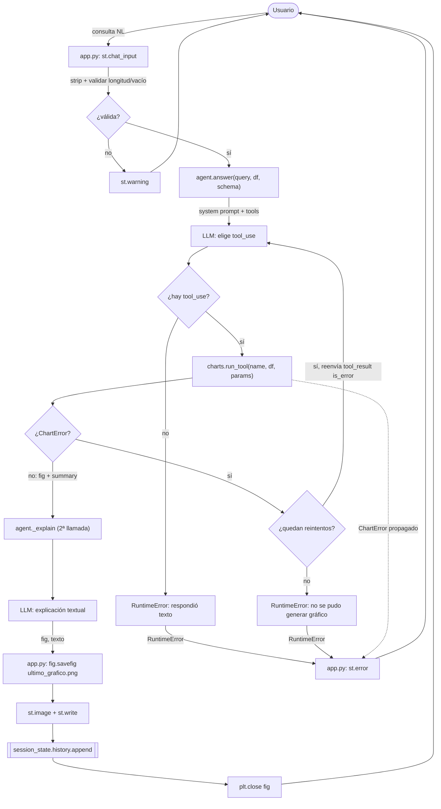

<!-- Generado por run-docs.sh el 2026-09-08 04:25 -->
# Flujo del producto

## Flujo end-to-end

El chatbot transforma una consulta en lenguaje natural sobre un dataset CSV en un gráfico
estático (PNG) acompañado de una explicación textual. El flujo real, derivado de `app.py`,
`src/chatbot/agent.py` y `src/chatbot/charts.py`, atraviesa las siguientes etapas.

1. **Carga del dataset (arranque de la app).** Al iniciar, `app.py` invoca `_load()`, una
   función cacheada con `@st.cache_data` que llama a `load_csv(config.CSV_PATH)` y a
   `schema_summary(df)`. Produce el `DataFrame` (`df`) y el resumen de esquema (`schema`,
   columnas/tipos) que después alimentará el system prompt. Si el CSV no existe
   (`FileNotFoundError`) o falla la carga, `app.py` registra el detalle en `stderr`, muestra
   un mensaje de error genérico al usuario con `st.error` y detiene la ejecución con
   `st.stop()`. En éxito, muestra un `st.caption` con nombre de archivo, filas y columnas.

2. **Restauración del historial de sesión.** `app.py` inicializa `st.session_state.history`
   como lista vacía si no existe, y renderiza cada interacción previa: el `query` del usuario
   y, del lado del asistente, la imagen (`img_bytes`) y el texto persistidos. Esto reconstruye
   la conversación en cada rerun de Streamlit.

3. **Recepción y validación de la consulta.** La entrada llega por `st.chat_input`. `app.py`
   aplica `query.strip()` y valida dos condiciones: que no quede vacía (`st.warning` si lo
   está) y que no supere `MAX_QUERY_LEN = 2000` caracteres (`st.warning` con el detalle si se
   excede). Solo si pasa ambas validaciones se continúa. La consulta válida se muestra en un
   `st.chat_message("user")`.

4. **Invocación del agente.** Dentro de un `st.chat_message("assistant")` con `st.spinner`,
   `app.py` llama a `answer(query, df, schema)` (de `agent.py`), pasándole la consulta, el
   DataFrame y el resumen de esquema. La llamada está envuelta en un `try/except` que
   distingue `ChartError`, `RuntimeError` y `Exception` genérica, cada uno con su propio
   mensaje de error al usuario.

5. **Construcción del system prompt y primera llamada al LLM.** En `agent.answer`,
   `get_client()` obtiene el cliente Anthropic; `_system_prompt(schema)` arma las
   instrucciones (elegir SIEMPRE una tool de graficado, usar nombres EXACTOS de columna, no
   inventar columnas) incrustando el esquema. Se inicializa `messages` con el rol `user` y la
   consulta. Se entra a un bucle de hasta `MAX_RETRIES + 1 = 2` intentos. En el primer intento
   (`attempt == 0`) se llama a `client.messages.create` con `tools=tool_schemas()` y
   `tool_choice={"type": "any"}` (forzando el uso de alguna tool); en el reintento se usa
   `{"type": "auto"}`.

6. **Extracción del tool_use.** De la respuesta se toma el primer bloque `tool_use`. Si no hay
   ninguno (Claude respondió texto en vez de elegir tool), `agent.py` levanta `RuntimeError`
   con el texto devuelto — lo que en `app.py` se traduce en el mensaje "Ocurrió un error al
   procesar tu consulta".

7. **Ejecución de la tool de graficado.** Con el nombre y los parámetros del `tool_use`,
   `agent.py` llama a `run_tool(name, df, params)` (de `charts.py`). `run_tool` valida que la
   tool exista en el dict `TOOLS` y ejecuta la función correspondiente (`bar_chart`,
   `line_chart`, `scatter_plot`, `histogram`, `pie_chart`). Cada función valida columnas y
   tipos mediante `_require_column` / `_require_numeric` / `_aggregate`, y ante un parámetro
   inválido (columna inexistente, no numérica, agregación inválida, falta de `y`, valores
   negativos en torta, o `TypeError` por firma) levanta `ChartError` con un mensaje legible. En
   éxito devuelve `(fig, summary)`: la figura matplotlib y un resumen textual de los datos.

8. **Reintento ante `ChartError`.** Si `run_tool` levanta `ChartError`, `agent.py` no aborta:
   añade a `messages` el bloque `assistant` con el `tool_use` original y un bloque `user` de
   tipo `tool_result` con `is_error: True` y el texto del error. Ejecuta `continue`, volviendo
   al inicio del bucle para un segundo intento en el que Claude puede corregir los parámetros.

9. **Camino de error definitivo.** Si el reintento también falla (o el bucle se agota sin
   producir figura), `agent.answer` levanta `RuntimeError("No se pudo generar un gráfico válido
   tras varios intentos.")`. Si el `ChartError` propaga hacia `app.py`, este muestra "No se
   pudo generar el gráfico con los parámetros solicitados. Intentá reformular la pregunta."

10. **Explicación textual (segunda llamada al LLM).** Con la figura ya generada, `agent.py`
    llama a `_explain(client, system, messages, resp.content, tool_use, summary)`. Esta arma un
    nuevo `messages` que incluye el `assistant_content` y un `tool_result` con el resumen de
    datos y la instrucción de explicar en 2-4 frases qué muestra el gráfico y el insight
    principal. Hace una segunda llamada a `client.messages.create` (esta vez **sin** `tools`) y
    extrae el texto concatenando los bloques `text`. Si no hay texto, levanta `RuntimeError`.
    `answer` devuelve la tupla `(fig, explanation)` a `app.py`.

11. **Persistencia y render del resultado.** De vuelta en `app.py` (rama `else`), se crea
    `config.OUTPUT_DIR` si no existe y se guarda la figura en disco con
    `fig.savefig(OUTPUT_DIR / "ultimo_grafico.png")`. Luego se serializa la figura a un
    `io.BytesIO` en PNG para obtener `img_bytes`, que se muestra con `st.image` junto al texto
    con `st.write`.

12. **Actualización del historial y limpieza.** Se agrega a `st.session_state.history` un dict
    `{"query", "img_bytes", "text"}`, de modo que la interacción sobreviva a los reruns
    (paso 2). El bloque `finally` cierra la figura con `plt.close(fig)` para liberar recursos,
    tanto en éxito como si la persistencia falla.

## Diagrama

