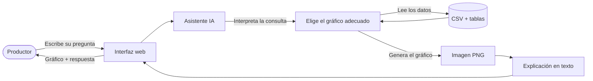

# Propuesta de proyecto — Asistente de análisis forrajero

**Trabajo Práctico Integrador — IA Agéntica — Maestría en Explotación de Datos (UBA)**

---

## El problema

Un productor ganadero necesita saber, en un momento dado, cuántos animales puede sostener un lote, qué pasó con el crecimiento de sus pasturas en la última sequía, o cuánto pasto necesita un conjunto de animales durante el invierno. Esa información está en tablas y registros de datos que existen, pero interpretarlos requiere o bien un técnico o bien manejo de planillas que la mayoría de los productores no tienen ni el tiempo ni la formación para dominar.

El problema no es que falten datos. El problema es que el usuario que los necesita no puede acceder a ellos por sus propios medios, en el momento en que los necesita, con la naturalidad de hacer una pregunta.

---

## La solución

Un chatbot conversacional que el productor usa desde el navegador. Le escribe en lenguaje natural —como si le preguntara a un técnico de confianza— y recibe una respuesta con un gráfico y una explicación en palabras simples.

Ejemplos de preguntas que el sistema puede responder:

- "¿Cuántas vacas puede sostener el lote 3 durante agosto?"
- "¿Cómo creció el pasto en la campaña 2023 comparado con 2022?"
- "¿Qué efecto tuvo la sequía del verano en el crecimiento de las pasturas?"
- "¿Cuánto pasto necesitan 50 novillos por semana?"

El sistema interpreta la pregunta, busca la información en los datos disponibles, genera un gráfico adecuado y devuelve una explicación que no supone conocimientos técnicos.

---

## Por qué necesita un modelo de lenguaje (y no alcanza con software convencional)

Un sistema convencional puede mostrar gráficos y tablas predefinidos, pero solo si el usuario ya sabe qué botón apretar, qué columna elegir, qué fórmula aplicar. El productor rural no tiene ese recorrido.

Lo que hace diferente a este sistema es que el usuario no necesita saber cómo están organizados los datos. Escribe lo que quiere saber, igual que en una conversación. El modelo de lenguaje entiende la intención —aunque la pregunta esté formulada de manera imprecisa o con vocabulario del campo— y la traduce a una consulta concreta sobre los datos.

Esa traducción entre lenguaje natural e interpretación de datos es exactamente lo que un modelo de lenguaje resuelve y un sistema de menús o filtros no puede.

---

## Datos que usa el sistema

### Fuente principal
Un archivo CSV con registros de tasas de crecimiento de pasturas por lote, campaña y período. Este dataset ya fue explorado y está disponible.

### Tablas complementarias (identificadas; integración próxima al MVP)
- **Tabla de equivalencias animales:** relación entre distintos tipos de ganado (vaca preñada, ternero, novillo, oveja) y su demanda de pasto en unidades comparables (Unidades Ganaderas). La tabla está identificada y disponible; deriva de estándares publicados por organismos internacionales de referencia en producción animal (INIA, CREA). Su integración en el sistema es la extensión inmediata al MVP.
- **Precipitaciones por fecha:** datos de lluvia que permiten correlacionar el clima con el comportamiento de las pasturas. Los datos son de dominio público y están disponibles a través del Servicio Meteorológico Nacional (SMN); la integración en el sistema es también una extensión próxima al MVP.

Todos los datos son propios o de origen conocido y de dominio público. No se usan fuentes externas en línea en tiempo real ni modelos entrenados sobre datos del productor.

---

## Cómo funciona el sistema

El flujo, desde la perspectiva del usuario, es simple:

Desde adentro, el sistema funciona así:

1. El modelo de lenguaje recibe la pregunta y el resumen de los datos disponibles.
2. Decide qué tipo de gráfico es adecuado para responder (barras, líneas, dispersión, histograma o torta) y qué columnas usar.
3. Llama a una herramienta predefinida que valida los parámetros y genera el gráfico.
4. Con el gráfico listo, el modelo redacta la explicación en lenguaje accesible.

El modelo nunca escribe ni ejecuta código sobre los datos directamente. Solo elige entre herramientas predefinidas con parámetros validados. Eso lo hace predecible y seguro.

---

## Cómo se mide que funciona

**Baseline de comparación:** una persona con criterio del rubro respondiendo las mismas preguntas consultando las planillas directamente.

**Proceso de evaluación:**
1. Se arma una batería fija de preguntas de dominio representativas (entre 15 y 25 preguntas).
2. Se registran las respuestas del sistema para ese conjunto de preguntas.
3. Un agente evaluador (LLM con rúbrica calibrada) asigna un puntaje a cada respuesta en las dimensiones: corrección factual, adecuación del gráfico, claridad de la explicación.
4. Como validación de la rúbrica, al menos una muestra de respuestas es evaluada también por una persona con conocimiento del dominio forrajero.

**Escala de puntaje:** cada respuesta se puntúa en tres dimensiones —corrección factual, adecuación del gráfico, claridad de la explicación— con valores 0 (incorrecto), 1 (parcial) o 2 (correcto), sumando hasta 6 puntos por respuesta. Se considera una respuesta correcta si obtiene 4 o más puntos sobre 6.

**Hipótesis:** el sistema responde correctamente al menos el 80% de las preguntas del conjunto de evaluación, medido por la rúbrica. La coincidencia con la evaluación humana se mide en la clasificación binaria correcto/incorrecto: hay acuerdo cuando el agente evaluador y el evaluador humano coinciden en si una respuesta es correcta (≥ 4 puntos) o no. Se espera al menos el 70% de coincidencia en la muestra calibrada.

La partición entre preguntas de desarrollo y de test es fija desde el inicio para evitar sobreajuste al conjunto visible.

---

## Mayor riesgo técnico y plan B

**Riesgo principal:** el modelo de lenguaje interpreta mal la pregunta y elige columnas o tipo de gráfico incorrectos para el caso. Esto produce respuestas que parecen válidas pero tienen contenido incorrecto, lo que para un productor puede ser más dañino que una respuesta en blanco.

**Mitigaciones en diseño:**
- Las herramientas de graficado validan las columnas y tipos de datos antes de ejecutar. Si los parámetros son inválidos, devuelven un error legible que el modelo puede usar para corregir su intento.
- El sistema hace hasta un reintento automático ante parámetros inválidos.
- Las columnas disponibles y su tipo se incluyen siempre en el contexto que recibe el modelo.

**Plan B:** si la interpretación automática resulta demasiado inestable en la evaluación, se agrega una etapa explícita de confirmación: el sistema muestra al usuario la interpretación que hizo de la pregunta ("Entiendo que querés ver las tasas de crecimiento del lote 3 entre junio y agosto. ¿Es correcto?") antes de generar el gráfico. Esto reduce la autonomía pero aumenta la confiabilidad.

---

## Costo de operar el sistema

El costo de operación depende principalmente del uso de la API del modelo de lenguaje (Claude, de Anthropic), que cobra por tokens procesados.

**Estimación por consulta:**
- Una consulta típica consume aproximadamente 800 tokens de entrada (contexto del sistema + resumen del dataset + pregunta del usuario) y 300 tokens de salida (parámetros del gráfico + explicación).
- A los precios actuales de Claude Sonnet, eso equivale a aproximadamente USD 0,003 por consulta (menos de medio centavo de dólar).

**Estimación mensual:**
- Con un uso moderado de 200 consultas por mes, el costo de API es del orden de USD 0,60 mensuales.
- El sistema corre en la máquina del usuario o en un servidor simple; no requiere infraestructura especializada para el MVP.

La factibilidad económica para un MVP es alta. Para una versión con múltiples usuarios simultáneos, el costo escala de forma lineal y puede modelarse con precisión antes de cualquier decisión de infraestructura.

**Latencia estimada:** el tiempo de respuesta típico de Claude Sonnet para una consulta de este tamaño (incluyendo generación del gráfico y redacción de la explicación) es del orden de 2 a 5 segundos. Este valor puede medirse con precisión una vez que el sistema esté operativo y ajustarse si se requiere menor latencia.

**Justificación del modelo frente a alternativas:** Claude Sonnet se eligió por su rendimiento en comprensión de lenguaje natural en español, disponibilidad vía API confiable y costo competitivo frente a modelos de capacidad comparable (por ejemplo, GPT-4o tiene un costo por token similar pero menor consistencia en español técnico de dominio agropecuario en pruebas preliminares). Los modelos locales de código abierto (por ejemplo, Llama 3 vía Ollama) son una alternativa de costo operativo cero, pero requieren hardware dedicado y tienen rendimiento inferior en español para tareas de comprensión de dominio específico; se consideran para versiones futuras si el costo de API se vuelve limitante.

---

## Alcance del MVP

**Dentro del alcance:**
- Preguntas sobre tasas de crecimiento de pasturas por lote, campaña y período.
- Cálculo de soporte animal (cuántos animales sostiene un lote en un período).
- Comparaciones entre campañas.
- Correlación entre precipitaciones y crecimiento.
- Estimación de demanda animal (cuánto pasto necesita un conjunto de animales).
- Interfaz web conversacional con historial de sesión.
- Un único dataset CSV como fuente de datos.

**Fuera del alcance:**
- Variables financieras: análisis de inversión, costo por kilo, rentabilidad por lote.
- Plan forrajero anual de largo plazo (12 meses): estrategias de acumulación estival y uso invernal.
- Múltiples usuarios simultáneos con sesiones separadas.
- Autenticación o control de acceso.
- Ingesta automática de nuevos datos.
- Recomendaciones agronómicas (el sistema describe e informa, no recomienda cursos de acción).

---

## Áreas de profundización del TP

El sistema cubre sustantivamente dos de las áreas requeridas:

**Uso de herramientas y function calling:** el modelo no genera código libre; elige entre herramientas de graficado predefinidas con contratos explícitos, validación de parámetros y manejo de errores con reintento. Esta es la decisión de diseño central del sistema.

**Evaluación:** el proceso de evaluación combina un juez LLM con rúbrica calibrada contra evaluación humana de dominio, sobre un conjunto de preguntas fijo y particionado. La calibración de la rúbrica es parte del entregable.
